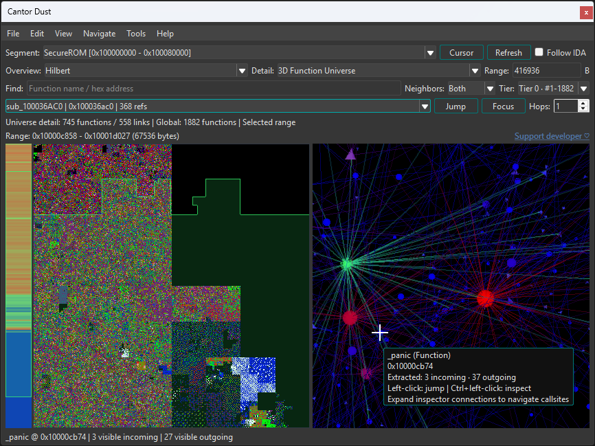
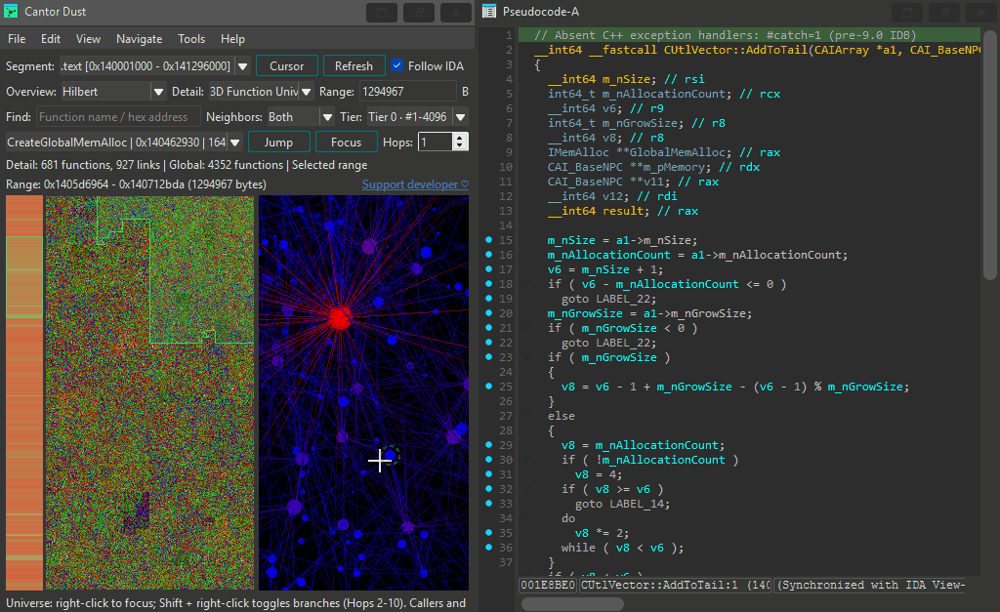
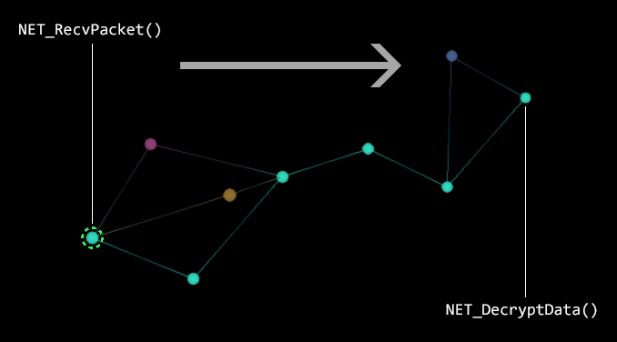
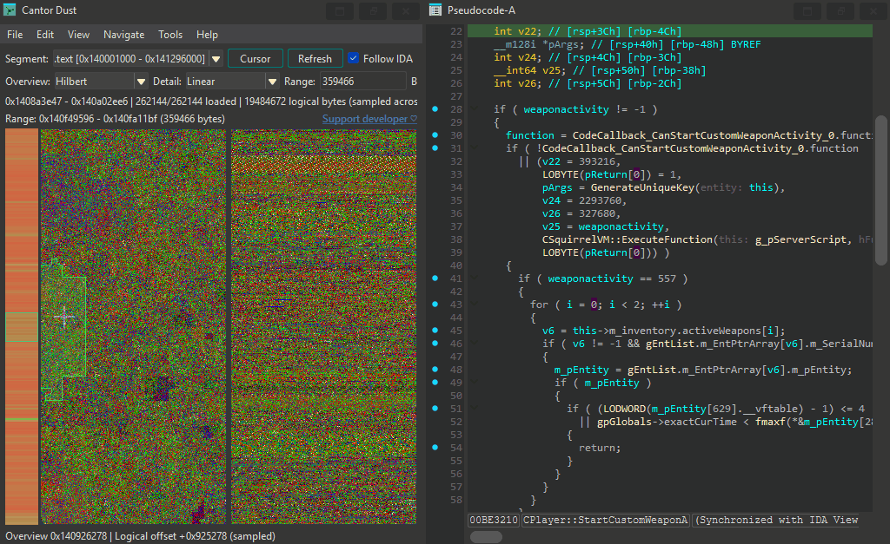
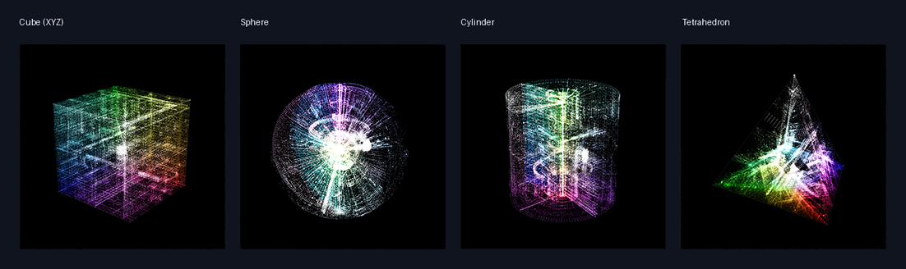
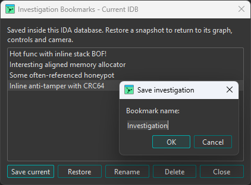
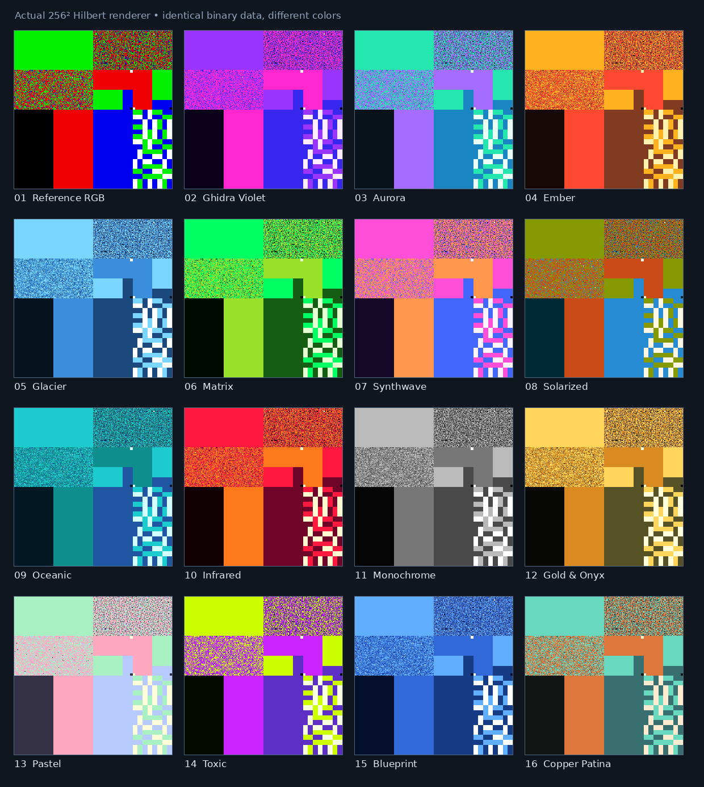
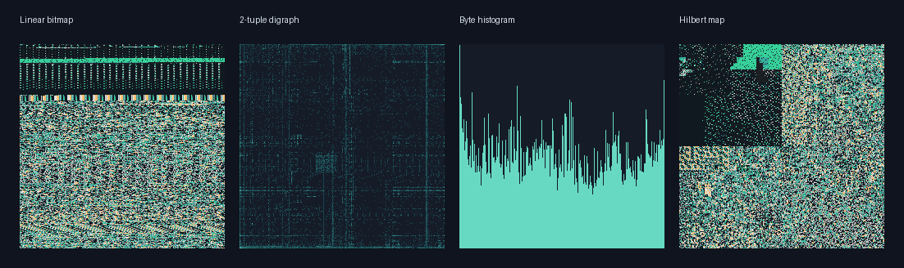

# Cantor Dust for IDA

Explore binary data and function relationships in a dockable IDA panel. Visualize bytes, spot patterns, and navigate straight to the disassembly. Everything renders entirely on the CPU!

## Installation

1. Download the plugin for your platform and IDA version from [Releases](https://github.com/Mauler125/Cantor-Dust-for-IDA/releases).
2. Copy the plugin (`.dll` on Windows) into IDA's `plugins/` directory.
3. Restart IDA and open **Edit > Plugins > Cantor Dust** (`Alt+C`).
4. :

## Features

### 3D Function Universe

Explore callers, callees, and function references in an interactive 3D network graph. Focus a function, expand its neighbors, and filter the view.

### Call Paths

Find all paths between two functions, inspect call sites, and jump to the relevant addresses in IDA. Useful for isolating code to just what's needed for finding bugs and vulnerabilities!

Use `Ctrl+Alt+Shift+S` to set the path start and `Ctrl+Alt+Shift+E` to set the path end, in either order. Both shortcuts are customizable through IDA's shortcut editor.

### Byte Maps

Inspect data with Linear, Digraph, Histogram, and Hilbert views. Use the entropy strip to spot transitions and select regions to investigate.

### 3D Byte Cloud

Explore byte distributions in cube, sphere, cylinder, and tetrahedron layouts.

### Investigation Bookmarks

Save named snapshots of your investigation, including the selected byte range, visualization settings, Function Universe focus, filters, call paths, and camera position. Bookmarks live in the current IDA database. Use **File > Investigation Bookmarks** to save, restore, rename, or delete them.

## Visualization Gallery

Compare the color palettes and visualization modes. Different views make different structures stand out!

**Color palettes**

**Byte visualization modes**

## References

- [CantorDust by Battelle](https://github.com/Battelle/cantordust)
- [binary_viewer by Kent A. Vander Velden](https://github.com/kentavv/binary_viewer)
- [Original demo by Christopher Domas](https://www.youtube.com/watch?v=4bM3Gut1hIk)
